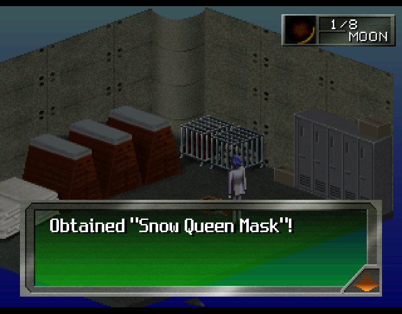
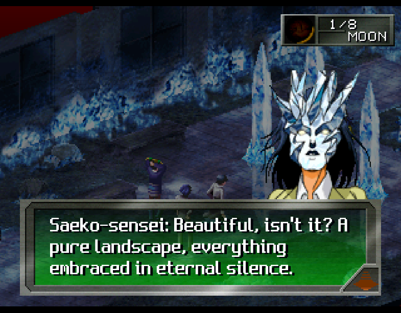
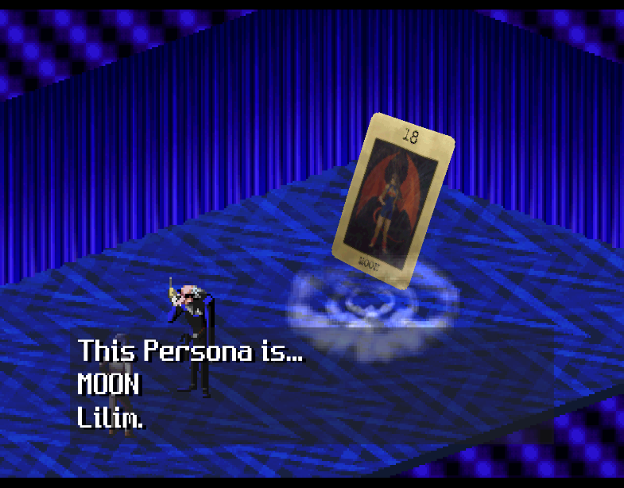
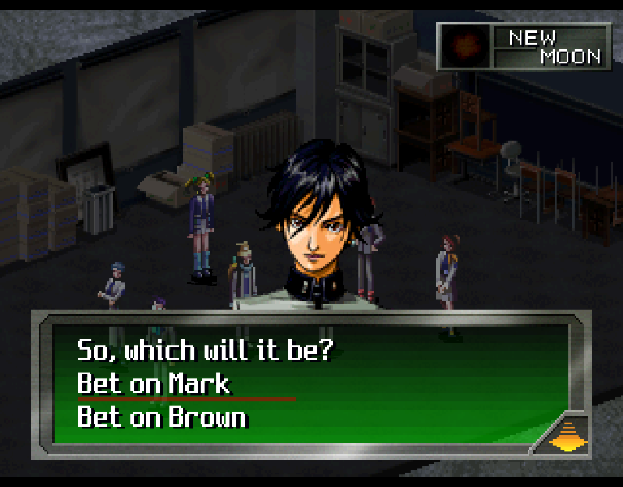
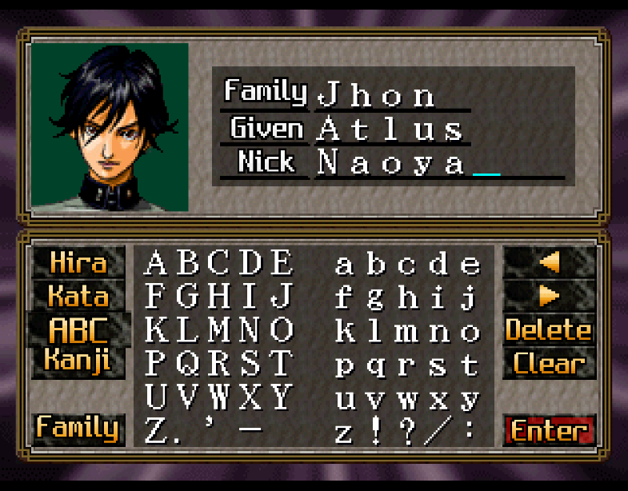
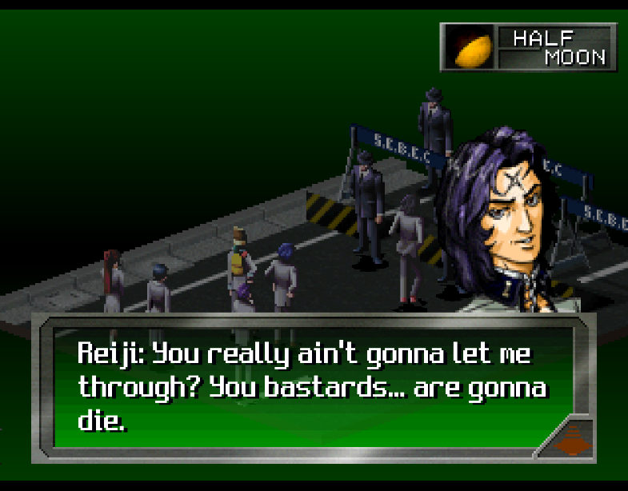

<h1 align="center"><a href="https://github.com/Redeted/megami-ibunroku-persona-ps1-translation/tree/psp-script">Not fond of MTL? Try the PSP script patch</a></h1>

# Megami Ibunroku Persona: Be Your True Mind — English Translation

A complete English translation of the original 1996 PlayStation release of *Megami Ibunroku Persona*
(Japan, SLPS-00500), with an optional enhancement patch.

<p align="center">
   
   
   
</p>

## Features

- **Fully translated**: the whole story of both routes (SEBEC and Snow Queen), every demon
  negotiation, battles, menus, items, skills, the Velvet Room, the overworld, the casino, name entry,
  the save screens and all endings.
- **Subtitled movies**: English subtitles in the spoken movies; the opening quote and the epilogue
  poems redrawn in English.
- A literal translation that keeps the original names, places and honorifics, using the official
  terminology of the 2009 PSP release for skills, items, demons and Personas.
- **Optional enhancement patch (QoL)**:
  - smooth movement in the 3D dungeons (up to 60 fps) and the overworld (up to 30 fps), while the
    game's own speed stays the original;
  - Persona summons and skill effects in battle at double speed (voices and sounds keep their normal
    speed);
  - half the random encounter rate;
  - x2 EXP, Persona points and money after battles.

## What you need

Your own copy of the game, as a single-track BIN/CUE of the **first release**:

| | |
|---|---|
| File | `Megami Ibunroku Persona - Be Your True Mind (Japan).bin` |
| Size | 699,705,888 bytes |
| CRC32 | `360EB310` |
| MD5 | `c0f167dd5133e2a0f89f772852a4e978` |

The later **"Rev 1"** release (699,672,960 bytes) is **not supported**: the patch will refuse to apply.

## Patching (easy way)

1. Download a patch from the [Releases](../../releases) page:
   - `Persona-TL.xdelta` – the translation;
   - `Persona-TL-QoL.xdelta` – the translation plus the enhancement patch.
2. Apply it to your `.bin` with any xdelta patcher, for example
   [Delta Patcher](https://github.com/marco-calautti/DeltaPatcher), or on the command line:
   ```
   xdelta3 -d -s "Megami Ibunroku Persona - Be Your True Mind (Japan).bin" Persona-TL.xdelta Persona-TL.bin
   ```
3. Open the patched `.bin` in your emulator through a `.cue` sheet. The release does not ship one:
   use the `.cue` that came with your own copy of the game. Its `FILE` line must name the patched
   `.bin`, so either
   - give the patched file the original name (`Megami Ibunroku Persona - Be Your True Mind (Japan).bin`,
     in another folder or replacing the original), or
   - keep the name you chose (e.g. `Persona-TL.bin`) and change the `FILE` line of a copy of the `.cue`
     to match. The whole sheet is just:
     ```
     FILE "Persona-TL.bin" BINARY
       TRACK 01 MODE2/2352
         INDEX 01 00:00:00
     ```
   (Any online or tool-made `.cue` for a single-track BIN works as well.)

## Playing

- Tested on [DuckStation](https://github.com/stenzek/duckstation).
- **For the QoL patch**, enable the CPU overclock: *Settings → Console → CPU Emulation*, enable clock
  speed control and set it to around **180%**. This gives 60 fps in the dungeons and a smooth 30 fps
  in the overworld. Without it the game still runs at its normal speed, just with fewer extra frames.
- Save states do not carry over between patch versions; use in-game memory-card saves when you update.

Known limitations (shortened names in some menus, untranslated staff names in the credits, …) are
listed in [RELEASE_NOTES.md](RELEASE_NOTES.md).

## Building from source

The repository contains the translation and all patches, but no game data: the build reads the files
from your own disc image.

Requirements:
- [Python](https://www.python.org/) 3.10 or newer, with `pip install capstone numpy opencv-python pillow`
- [armips](https://github.com/Kingcom/armips) 0.11: put `armips.exe` (or `armips`) in `tools/armips/`
  or on your PATH
- Optional, for the movie subtitles: Java and [jPSXdec](https://github.com/m35/jpsxdec) 2.1, unpacked so
  that `tools/ext/jpsxdec/jpsxdec.jar` exists. Without it the movies keep their Japanese text.

Build:
```
python tools/build.py --image "path/to/Megami Ibunroku Persona - Be Your True Mind (Japan).bin"
python tools/build.py --image "path/to/Megami Ibunroku Persona - Be Your True Mind (Japan).bin" --qol
```
The first run extracts the game files into `original/`. The results are written next to the
repository folder: `../patched/Persona-TL.bin/.cue` and `../patched_qol/Persona-TL-QoL.bin/.cue`.
A full build takes about 10 minutes.

Developer notes: [DEVELOPMENT.md](DEVELOPMENT.md), and the enhancement patch in [qol/README.md](qol/README.md).

## Legal

This is an unofficial, non-commercial fan translation. It is not affiliated with or endorsed by Atlus or any rights holder; *Megami Ibunroku Persona* and all related names and assets belong to their respective owners.

- The repository and the release patches contain **no game data**: the patches are xdelta differences that only work on a disc image you supply yourself. Use only an image created from media you own, where permitted by applicable law.
- Do not commit game binaries, CUE sheets, extracted disc files or save states to this repository (the `.gitignore` is a whitelist for that reason).
- `translation/*.tsv` list the original Japanese script lines next to the English text, as translation sources. They are quoted for the purpose of the translation only.
- Only the first release (SLPS-00500, 699,705,888 bytes) is supported; other revisions are not.

The tools, assembly sources and translation text written for this project are released under the [MIT licence](LICENSE).
